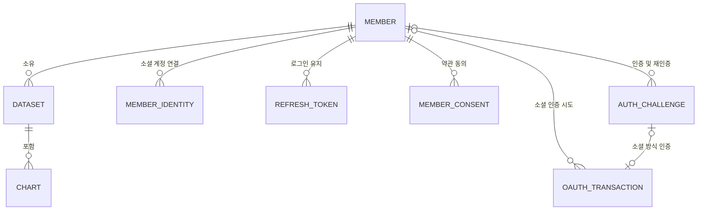
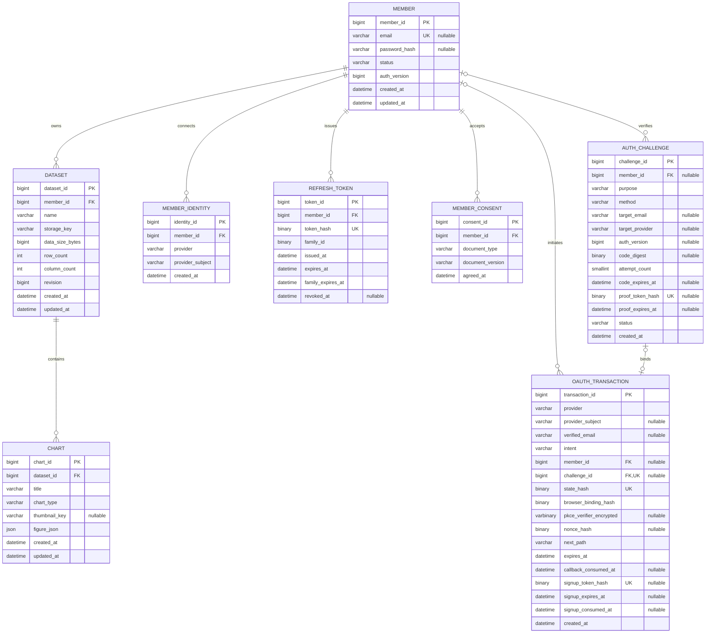

# 회원·인증 ERD 검토안

기준일: 2026-10-31. **사용자 합의 정책 반영 / DDL 검토본 / DB 미적용.**
기준 SQL: 프로젝트 루트 `sql-file.sql`. 필수 인증·약관 동의 후 회원 생성 정책을 반영한다.
기존 MVP_DESIGN.md의 member NOT NULL 및 인증 보조 테이블 설명보다 이 문서의 최신 회원·인증 정의를 우선한다.

## SQL 선택
- `../sql/03_full_schema_review.sql`: mac 스키마에 대상 테이블 8개가 없는 경우의 전체 생성본.
- `../sql/02_auth_additions_review.sql`: 원본과 정확히 같은 member/dataset/chart가 이미 있는 경우의 변경본. member ALTER + 5개 CREATE.
- `../sql/04_signup_after_consent_alter_review.sql`: 이전 8테이블 검토안을 이미 적용한 DB용 ALTER. member 상태 변경, OAuth 가입 대기 정보 추가 및 callback 소비 시각 이름 변경.
- 현재 DB에 맞는 파일 하나만 선택한다. 최신 02/03에는 04의 변경이 이미 포함되어 있으므로 이어서 실행하지 않는다. 현재 DB 스키마·데이터는 조사하거나 변경하지 않았다.
- 04 실행 전 PENDING_TERMS 행이 없어야 한다. 남아 있다면 동의 증거와 데이터를 확인하여 별도 전환 계획을 세워야 한다. 자동 활성화·삭제하지 않으며 새 CHECK가 해당 행이 있으면 member ALTER를 거절한다. 02로 기존 회원에 ACTIVE를 추가하는 경우에도 실제 약관 동의 이력 점검이 선행되어야 한다.
- CREATE DATABASE, DROP, 데이터 삭제, 자동 Flyway 실행은 포함하지 않는다. DDL은 트랜잭션 ROLLBACK을 전제로 실행할 수 없다.
- MySQL 8.0.16 이상(기존 환경 기록 8.0.33 기준). 연결마다 UTC 설정이 필요하며 SQL의 SET SESSION은 해당 연결에만 적용된다.

## 관계 요약

채팅에서 제시한 관계도이다. Mermaid를 지원하는 Markdown 뷰어에서 이미지 형태로 렌더링된다.

## 전체 컬럼 ERD

## 컬럼과 최소화 결정

### member
- 기존 email/password_hash만 NULL 허용으로 바꾸고 status/auth_version을 추가한다.
- email: 검증된 서비스 이메일만 저장. 공백 제거·소문자화 정책을 서버에서 일관되게 적용. 기존 대소문자 비구분 collation과 UNIQUE 유지. 소셜 이메일이 없거나 신뢰 불가하면 NULL. 신뢰 가능한 이메일이 기존 회원과 중복되면 신규 가입 거절(충돌 회피를 위해 NULL로 바꾸지 않음).
- password_hash: BCrypt. 비밀번호가 있으면 email도 있어야 한다는 CHECK 적용. 이메일만 있고 비밀번호가 없는 소셜 회원은 허용.
- status: ACTIVE / DELETING. 기본값은 ACTIVE. 최초 가입용 PENDING_TERMS는 제거한다. 이메일·소셜 모두 필수 인증과 약관 동의 완료 후에만 회원을 생성한다. 기존 회원에게 동의 이력을 만들어내지 않는다.
- auth_version: 비밀번호 재설정·이메일 변경 등 보안 변경 시 증가. JWT/인증 증명 발급 당시 값과 현재 값을 비교해야 실제 무효화가 된다. 현재 JWT 설정에 이미 구현되어 있다는 뜻이 아니다.
- 이메일 검증 시각, 이름, 프로필, 전화번호, last_login_at은 제외.

### member_identity
- member_id: 연결 소유자. provider: GOOGLE/KAKAO/NAVER. provider_subject: 해당 앱에서 제공사가 발급한 불변 ID.
- UNIQUE(provider, provider_subject): 다른 회원에게 중복 연결 금지.
- UNIQUE(member_id, provider): 회원당 제공사별 계정 하나.
- provider_subject는 대소문자·끝 공백까지 식별에 영향을 주도록 utf8mb4_0900_bin 사용. 앱 환경별 issuer/client ID는 서버 설정으로 관리하는 단일 앱 구성 전제.
- 제공사 이메일·사진·토큰·로그인 시각은 저장하지 않는다. 제공사 API 연속 호출이나 자동 연결 해제까지 필요해지면 토큰 보관을 별도 검토한다.

### auth_challenge
- purpose: SIGNUP/PASSWORD_RESET/EMAIL_CHANGE/PASSWORD_SET/PASSWORD_CHANGE/IDENTITY_LINK/IDENTITY_UNLINK/ACCOUNT_DELETE.
- method: EMAIL_CODE/PASSWORD/SOCIAL. 코드·비밀번호·소셜로 확인한 결과를 같은 proof 구조로 소비한다.
- member_id/auth_version: 대상 회원과 발급 당시 인증 버전. SIGNUP은 둘 다 NULL. 회원 대상 작업은 둘 다 필수라는 규칙을 서비스에서 보장한다.
- target_email: 가입·복구·새 이메일 검증 대상. 이메일 변경 재인증도 새 이메일에 묶어 발급한다.
- target_provider: 연결/해제 대상 제공사. 실제 재인증에 사용한 제공사는 oauth_transaction.provider일 수 있으므로 두 역할을 혼동하지 않는다.
- code_digest: HMAC-SHA-256 원시 32바이트. 서버 비밀키는 DB 밖에서 보관. attempt_count와 code_expires_at으로 시도 횟수·만료를 제어한다.
- proof_token_hash: 무작위 verificationToken/reauthToken의 SHA-256 원시 32바이트. proof_expires_at까지 유효.
- status: PENDING → VERIFIED → CONSUMED. 재발송·취소는 CANCELLED. 만료는 시각 비교로 판단하므로 EXPIRED 상태는 없다.
- 이메일 코드와 증명 토큰의 수명이 달라 만료 시각 둘은 유지한다. verified_at/consumed_at은 감사 이력 요구가 없으므로 제외하고 상태로 처리한다.
- 이메일 변경은 새 주소 인증과 현재 계정 재인증의 서로 다른 두 challenge를 요구한다. 목적이 같더라도 method가 다른 증명 둘을 한 트랜잭션에서 검사·소비한다.
- 비밀번호 찾기에서 실제 회원이 없는 경우 응답 형식은 같게 하되 유효한 회원용 proof를 발급하지 않는다. 실재하지 않는 회원의 DB 행 생성은 필요하지 않다.
- 재인증 method=SOCIAL은 연결된 동일 provider_subject와 실제 최근 인증 여부를 검증해야 한다.

### refresh_token
- token_hash: 무작위 refresh token의 SHA-256. access JWT는 DB 저장하지 않는다.
- family_id: 로그인마다 새 16바이트 난수, 회전 시 유지. UUID 문자열을 사용한다면 바이너리 변환 방식도 통일한다.
- expires_at: 개별 만료. family_expires_at: 연속 재발급의 절대 기한. revoked_at: 회전·로그아웃·재사용 감지 시 폐기.
- replaced_by_id, 기기 정보, IP는 제외. 폐기 토큰은 재사용 감지를 위해 family 만료까지 보존한다.
- 같은 family는 같은 member_id/family_expires_at을 유지한다. 별도 family 엔티티 대신 서비스에서 member 행 잠금 후 재발급·family 폐기를 직렬화한다.
- 로그아웃은 현재 refresh family만 폐기하고 다른 기기는 유지한다. FE는 메모리 Access와 회원 정보를 제거한다. 기존 Access JWT는 최대 10분의 잔여 유효시간을 허용한다.

### oauth_transaction
- LOGIN: member_id/challenge_id NULL. LINK/REAUTH: 둘 다 필수, challenge.member_id와 동일해야 한다.
- challenge_id UNIQUE: challenge 하나에 OAuth 시도 하나. 재시도는 새 challenge/transaction을 만들고 이전 시도를 취소한다.
- state_hash/browser_binding_hash: 요청과 callback 및 시작 브라우저를 연결. PK나 state의 존재만으로 인증 성공 처리하지 않는다.
- pkce_verifier_encrypted: 원문 교환이 필요하므로 해시가 아닌 인증된 암호화 봉투(key ID/nonce/tag/ciphertext). 키는 DB 밖에 보관.
- nonce_hash: OIDC nonce 검증용. 해당 플로우에서 PKCE/OIDC를 쓰는 경우 관련 값이 필수인지 서비스가 검사한다.
- next_path: 서비스 내부 allowlist 경로만 저장. URL 정규화·외부 URL/우회 인코딩 검사는 서비스 책임.
- expires_at/callback_consumed_at: OAuth 시도 만료·callback 중복 처리 방지. 기존 consumed_at을 callback_consumed_at으로 변경한다. code 교환 중 경쟁은 DB 조건부 claim 등으로 막고 실패 시 새 시도로 재시작한다.
- provider_subject: BE가 검증한 제공사 사용자 ID. verified_email: 서비스 이메일로 신뢰 가능한 제공사 이메일만 저장하며 없거나 신뢰 불가하면 NULL. 인증 시작 시 둘 다 NULL이다.
- signup_token_hash: 무작위 가입용 일회성 증명의 SHA-256 원시 32바이트, UNIQUE. signup_expires_at은 가입 기한, signup_consumed_at은 최종 가입 소비 시각이다.
- 기존 소셜 회원은 로그인하며 가입 증명을 발급하지 않는다. 신규 회원만 callback 검증 후 가입 증명을 발급하며 member/identity/consent/refresh는 아직 생성하지 않는다.
- 신규 가입 증명은 intent=LOGIN, 검증된 provider_subject, callback_consumed_at이 있을 때만 저장 가능하다. 증명과 만료는 동시에 존재하며 소비 시각은 callback 이후 및 가입 만료 이전이어야 한다.
- signup proof 전달·소비는 시작 브라우저에 묶는다. 소셜 신규 가입은 member_id/challenge_id NULL인 OAuth 기록의 signup proof를 사용한다. 기존 회원의 LINK/REAUTH는 회원 및 auth_challenge의 proof와 연결한다.
- /auth/signup에서 필수 약관·미소비 가입 증명·브라우저·만료를 확인하고 이메일/소셜 ID 중복을 다시 검사한다. member+member_identity+member_consent+refresh_token 생성과 signup_consumed_at 갱신은 같은 DB 트랜잭션에서 수행한다. 중복 가입 경쟁은 행 잠금/조건부 소비와 UNIQUE로 차단한다.
- 가입 도중 이탈하면 회원을 만들지 않고 임시 정보를 만료·정리한다. expires_at만으로 정리하지 않는다. 정리 조건은 expires_at <= 현재 UTC AND (signup_expires_at IS NULL OR signup_expires_at <= 현재 UTC)로 잡아 유효한 가입 증명을 보존한다. 만료된 개인정보도 정기 정리한다.

### member_consent
- document_type + document_version + agreed_at: 어떤 문서 버전에 언제 동의했는지 저장.
- UNIQUE(member_id, document_type, document_version)으로 중복 제출 방지. 개정 동의는 INSERT, 과거 행을 덮어쓰지 않는다.
- TERMS/PRIVACY는 현재 화면상의 필수 문서 기록을 위한 구분이다. 선택 동의·철회 이력은 이번 범위 밖.
- 문서 원문은 버전별 불변 파일로 유지. 별도 약관 관리 테이블·IP·User-Agent 제외.
- 필수 동의는 회원 생성 전에 검증하고 가입 트랜잭션에 기록한다. 최초 가입용 needsTerms 회원 상태 또는 별도 회원 동의 완료 요청을 전제로 하지 않는다. 문서 원문·화면은 FE, 필수 버전 검증·동의 이력은 BE 책임이다. 가입 후 약관 개정 재동의는 이번 최초 가입 정책과 별개다.

## FK 삭제 정책
| 부모 → 자식 | 정책 | 이유 |
|---|---|---|
| member → dataset | RESTRICT, 기존 유지 | S3 정리 전에 회원만 지우는 실수 방지 |
| dataset → chart | CASCADE, 기존 유지 | 데이터셋의 하위 차트 동시 제거 |
| member → 인증용 5개 테이블 | CASCADE | 회원 최종 삭제 시 연결·인증·동의 기록 제거 |
| auth_challenge → oauth_transaction | CASCADE | 만료 인증 정리 시 관련 임시 OAuth 상태도 제거 |

동의 이력은 회원 존속 중 조회하는 범위다. 탈퇴 후 보존이 필요한 별도 정책은 아직 없다.
탈퇴는 재인증 → DELETING/토큰 폐기 → S3 정리 → dataset 삭제 → member 최종 삭제 순서가 가능하다.
**8개 테이블만으로 S3 삭제 재시도까지 구현되는 것은 아니다.** 이번 ERD에서 기존 저장 구조는 유지했다. 저장 객체/삭제 작업 테이블은 기존 STORAGE 설계의 후속 범위이며, 이를 구현하기 전에는 dataset/chart 참조를 남긴 채 DELETING 상태에서 S3 정리를 완료해야 한다. 실패 시 참조를 지우지 않고 재시도한다.

## DB 제약과 서비스 책임의 경계
- DB: PK/FK/UNIQUE, 열거 상태 CHECK, 만료 시각의 순서, 코드·증명 필드 쌍, 비밀번호가 있을 때 이메일 존재.
- 서비스: 마지막 로그인 수단 보장, 상태 전이, 회원/목적/대상/버전 일치, 활성화 전 약관·로그인 수단 확인, 코드 발송 제한, 인증 단일 소비, refresh 회전 경쟁, next 경로 검증.
- MySQL CHECK는 FK 참조 행을 조회할 수 없다. FK 삭제 동작이 있는 컬럼을 CHECK로 검사하는 제약도 피하고 서비스 검증 대상으로 명시했다.
- 회원 생성+소셜 연결, 인증 proof 소비+업무 변경은 각각 단일 DB 트랜잭션이다. 이메일·S3 같은 외부 작업까지 DB 트랜잭션이 원자성을 제공하지 않는다.
- 동일 이메일의 기존 계정과 자동 병합하지 않는다. 이미 연결된 소셜 ID는 기존 회원 로그인, 처음 보는 소셜 ID의 신뢰 가능한 이메일이 기존 서비스 이메일과 같으면 신규 가입 거절. 로그인 후 명시적 소셜 연결은 별도 기능이다.

## 검증 범위
- 원본 dataset/chart CREATE 정의를 그대로 보존하고 전체 생성본과 변경본의 인증 테이블 일치 여부를 정적으로 비교한다.
- PK/FK 타입, 테이블 생성 순서, 제약 이름 중복 및 필수 UNIQUE를 점검한다.
- MySQL 실제 실행, DB migration, Java entity/API 구현은 수행하지 않았다. ERD 확정 후 별도 빈 테스트 DB에서 실행 검증이 필요하다.
- 참고: https://dev.mysql.com/doc/refman/8.0/en/create-table-foreign-keys.html
