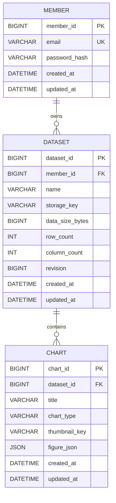

# MAC Studio MVP 설계 및 프론트엔드 연동 기준

기준일: 2026-10-27 (Asia/Seoul)

> 2026-10-31 회원·인증 확장안은 [ERD 검토 문서](AUTH_ERD_REVIEW.md)를 참고한다.
> 아래 member/인증 스키마는 종전 기준이다. 최신 ERD와 [가입·로그인 AUTH 명세](AUTH_API.md)를 우선하며 모두 DB/API 미구현이다.

이 문서는 프론트엔드·백엔드 개발자가 공유하는 설계 기준이다. **설계 확정은 구현 완료를 의미하지 않는다.** 실제 제공 중인 API와 구현 예정 사항을 구분한다. 실행 방법과 환경 설정은 [README](../README.md)를 참고한다.

## 1. 현재 구현 상태

| 영역 | 상태 |
|---|---|
| Spring Boot 프로젝트, 도메인별 패키지 | 준비 완료. health 외 업무 도메인은 대부분 패키지만 존재 |
| JWT 검증 기반 | HS256, issuer, audience, exp, sub 검증 및 BCrypt 구성 완료 |
| 로컬 MySQL | mac DB 연결 확인 완료. 업무 테이블 migration·entity는 미구현 |
| 회원가입·이메일 인증·로그인·재발급·로그아웃 | 미구현 |
| 데이터셋·차트 CRUD, revision 충돌 처리 | 미구현 |
| S3 데이터·썸네일 저장 및 삭제 재시도 | 설계 단계. 실제 AWS 연결 미검증 |
| Swagger / 기본 HTTP·Security 테스트 | 제공 중. 업무 API 연동 완료를 의미하지 않음 |

2026-10-26 기준 기본 테스트 4개와 MySQL 연결 테스트 1개 통과 기록이 있다. MySQL 업무 스키마·동시성·S3 정합성 검증은 이후 구현 시 수행한다.

## 2. 확정된 범위와 기술 구조

- Java 17, Spring Boot 4.1.1, Gradle, MySQL, private S3를 사용한다.
- 도메인별 `controller → service → repository` 계층과 `dto/entity`를 사용한다. 헥사고날·CQRS는 도입하지 않는다.
- 인증은 JWT Bearer 기반이다. 기존 Spring Security Resource Server/Nimbus 구성을 유지한다.
- 핵심 관계는 **member 1:N dataset 1:N chart**다. 폴더 하나는 데이터셋 하나이며 별도 folder/project 테이블은 두지 않는다.
- 같은 데이터셋의 모든 차트는 현재 데이터를 공유한다. 차트 하나가 여러 데이터셋을 참조하는 중간 테이블은 없다.
- MVP 차트 종류는 BAR / LINE / PIE다.
- 결제·구독·유료 플랜, 팀 공유, 휴지통·버전 복원, 서버 차트 렌더링은 MVP에서 제외한다.

## 3. 핵심 ERD — 확정 설계, 아직 DB 적용 전



### 컬럼·제약조건

| 테이블 | 컬럼 및 규칙 |
|---|---|
| member | `email VARCHAR(254) UNIQUE NOT NULL`, `password_hash VARCHAR(255) NOT NULL` |
| dataset | `member_id NOT NULL`, `name VARCHAR(120) NOT NULL`, `storage_key VARCHAR(512) NOT NULL` |
| dataset | `data_size_bytes BIGINT UNSIGNED`, `row_count/column_count INT UNSIGNED`는 NOT NULL |
| dataset | `revision BIGINT UNSIGNED NOT NULL DEFAULT 1` |
| chart | `dataset_id NOT NULL`, `title VARCHAR(255) NOT NULL DEFAULT ''`, `chart_type VARCHAR(30) NOT NULL` |
| chart | `thumbnail_key VARCHAR(512) NULL`, `figure_json JSON NOT NULL` |

- PK/FK는 BIGINT UNSIGNED, PK는 AUTO_INCREMENT. API에서는 ID를 **문자열**로 전달한다.
- 생성·수정 시간은 `DATETIME(3)`, UTC, NOT NULL. 화면 표시는 클라이언트 시간대로 변환한다.
- `UNIQUE dataset(member_id, name)`: 같은 회원의 데이터셋 이름 중복은 거절한다. 이름으로 기존 데이터를 덮어쓰지 않는다.
- 목록 조회 인덱스는 `dataset(member_id, updated_at)`, `chart(dataset_id, updated_at)` 방향이다.
- 이메일은 정규화한다. 구체적인 정규화·collation 정책은 DDL/API 구현 전에 확정한다.
- 차트 소유자는 `chart → dataset.member_id`로 확인한다. chart에 member_id를 중복 저장하지 않는다.
- dataset 삭제 시 하위 chart도 삭제하며, S3 삭제 작업을 같은 DB 트랜잭션에 기록한다. chart만 삭제하면 dataset은 유지한다.
- soft delete 컬럼은 두지 않는다. 실제 FK 삭제 옵션은 S3 정리 기록 보존을 고려해 migration에서 확정한다.

### 차트 설정 JSON

`figure_json`은 선택 조건과 스타일만 보관한다. id/title/type은 일반 컬럼에서 조립하며 중복 저장하지 않는다.

- 구조 버전: `schemaVersion=1`
- 데이터 선택: `labelCol`, `valueCol`, `rowStart`, `rowEnd`, `topN`, `topMode`, `groupOthers`
- 스타일: `titleStyle`, `subtitle`, `subtitleStyle`, `footer`, `color`, `bg`, `barWidth`, `barShade`, `textSize`, `textBold`, `legend`, `legendSize`, `legendBold`
- headers/rows, 계산된 series, 렌더링 이미지는 넣지 않는다.
- 현재 프론트와 맞춰 열 index를 사용한다. 열 구조 변경 시 유효 범위를 검증한다.
- 위 목록은 저장 방향이며 필드별 타입·필수 여부·기본값·범위는 API DTO 구현 시 확정한다.

## 4. 인증·저장 보조 테이블 — 방향 합의, 상세 DDL 미확정

다음은 핵심 3개 테이블과 구분되는 설계 후보다. 완성된 migration으로 간주하지 않는다.

| 테이블 | 목적 | 컬럼 후보 |
|---|---|---|
| email_verification | 가입 전 이메일 인증, 시도·재발송 제한, 단일 소비 | verification_id, email, code_digest, attempt_count, last_sent_at, expires_at, verified_at, consumed_at |
| refresh_token | 재발급·회전·폐기·재사용 탐지 | token_id, member_id, token_hash, family_id, issued_at, expires_at, revoked_at, replaced_by_id |
| storage_object | S3 객체 상태와 삭제 재시도 | object_id, member_id, storage_key, object_type, status, size_bytes, created_at, expires_at, retry_count, next_retry_at |

- 이메일 인증은 회원 생성 전 발생하므로 member FK를 필수로 두지 않는다. 인증코드 원문 대신 비밀키 기반 digest를 저장한다.
- refresh token은 원문 대신 해시를 저장한다. `token_hash`는 UNIQUE 방향이다. Redis 도입은 확정하지 않았다.
- storage_object의 `storage_key`는 UNIQUE, object_type은 DATASET/THUMBNAIL, 상태는 PENDING/ACTIVE/DELETE_PENDING 방향이다.
- 삭제 대기 기록은 회원·차트 삭제 CASCADE로 사라지면 안 된다. 객체 관계와 FK 삭제 규칙, 정리 작업의 claim/lease 필드는 구현 전에 확정한다.

## 5. 인증과 프론트엔드 연동

최신 확정 계약은 [AUTH API 명세](AUTH_API.md), 스키마는 [회원·인증 ERD](AUTH_ERD_REVIEW.md)를 따른다.

- 이메일·소셜 모두 필수 인증과 약관 동의 완료 후 공통 /auth/signup에서 회원 생성·자동 로그인한다.
- 소셜 신규 인증 결과는 OAuth 임시 기록에만 보관하며 가입 전 회원/로그인 토큰을 만들지 않는다.
- 약관 원문/화면은 FE, 필수 버전 검증/동의 이력은 BE. 최초 가입용 PENDING_TERMS 또는 /me/terms를 사용하지 않는다.
- Access JWT는 FE 메모리에 보관하여 Bearer로 전달한다. 회원 식별·소유권은 JWT sub와 DB 관계로 확인한다.
- Refresh는 HttpOnly 쿠키·DB 해시 저장·회전/재사용 탐지. 로그아웃은 현재 family 폐기, 다른 기기는 유지하며 Access 잔여 최대 10분을 허용한다.
- 로그인 실패는 INVALID_CREDENTIALS로 통일한다. 같은 이메일이라는 이유로 소셜 계정을 자동 병합하지 않는다.
- 쿠키/Origin/CSRF/CORS를 함께 구현한다. 소셜 신규 가입 증명 전달 세부 계약 및 운영 제한값은 공유 명세에서 미확정으로 구분했다.
- 위 AUTH API는 아직 호출할 수 없다. 비밀번호 복구·계정 관리·재인증·탈퇴는 후속 명세 범위다.

## 6. 데이터·썸네일 저장 흐름

MySQL에는 소유권·메타데이터·차트 설정 JSON·저장 객체 상태를 둔다. S3에는 **편집 후 현재 headers/rows JSON과 썸네일 이미지**를 둔다. 원본 CSV/XLSX만 저장해서는 편집 상태를 복원할 수 없다.

```text
브라우저에서 파일 파싱·표 편집·차트 구성
  → 로그인 후 저장 요청
  → 서버에서 소유권·형식·용량 검증
  → 서버가 고유 객체 키와 PENDING 기록 생성
  → 변경된 데이터/썸네일을 S3에 업로드
  → 짧은 DB 트랜잭션에서 revision·용량 재확인
  → 참조 교체 + 새 객체 ACTIVE + 이전 객체 DELETE_PENDING + revision 증가
  → 커밋 후 이전 객체 삭제, 실패하면 재시도
```

- MVP는 백엔드 업로드를 기본으로 한다. 사용자가 ACTIVE S3 객체를 직접 덮어쓰거나 삭제하도록 허용하지 않는다.
- DB에는 URL 대신 object key를 저장한다. 다운로드 URL은 소유권 확인 후 필요할 때 생성한다.
- dataset과 하위 chart를 하나의 revision 경계로 본다. 차트 변경도 dataset revision/updated_at을 갱신한다.
- 저장 시 클라이언트의 expectedRevision과 현재 revision을 비교한다. 충돌은 409로 처리하고 무조건 덮어쓰지 않는다. 정확한 요청 DTO와 충돌 화면 동작은 연동 시 확정한다.
- 업로드 실패·충돌 시 이전 정상 저장 상태를 유지하고 새 객체를 정리한다. 같은 저장 요청의 재시도는 멱등 처리한다.
- 차트 스타일만 변경하면 해당 썸네일만 교체하고 데이터 JSON은 재업로드하지 않는다.
- 데이터가 변경되면 같은 데이터셋의 모든 썸네일을 무효화한다. `thumbnail_key=NULL`은 정상적인 미생성/무효화 상태다.
- 프론트는 썸네일이 없으면 차트 렌더링 또는 대체 표시를 제공해야 한다. 현재 revision에 맞는 썸네일만 저장한다.
- 만료된 PENDING과 DELETE_PENDING을 정리하며 현재 참조 중인 객체는 삭제하지 않는다.

## 7. 화면별 책임과 용량

| 화면/기능 | 연동 기준 |
|---|---|
| 메인·가이드 | 정적 콘텐츠 |
| 스튜디오 | 브라우저에서 CSV/XLSX 파싱. 저장 시 서버가 내용 재검증 |
| 편집기 | 현재 데이터와 차트 설정 복원, revision 기반 저장 |
| 마이페이지 | 소유 데이터셋·차트·썸네일 목록, 삭제, 서버 계산 사용량 |
| 비회원 작업 | 브라우저에서만 작업. 로그인 후 최초 저장 시 서버 리소스 생성 |
| 이미지·CSV 추출 | 브라우저 처리 유지. 서버 렌더링은 MVP 제외 |

현재 프론트 기준은 회원 파일 업로드 10MiB, 비회원 브라우저 업로드 5MiB, 회원 저장 한도 30MiB다. **서버에서 구현·검증된 제한은 아니다.**

저장량은 활성 데이터 JSON + 활성 썸네일 + 차트 설정 JSON의 UTF-8 크기를 서버가 계산하는 방향이다. 원본 파일 크기와 정규화 JSON 크기는 다르므로 서버 요청·이미지별 제한과 동시 저장 용량 검사는 구현 시 확정한다.

## 8. 현재 호출 가능한 API와 향후 계약

| 경로 | 현재 상태 |
|---|---|
| GET /api/v1/health | 공개, 프로세스 상태 확인. DB/S3 정상 여부를 뜻하지 않음 |
| GET /actuator/health | 공개, 활성화된 health contributor 상태. 상세 정보 비공개 |
| GET /v3/api-docs | local에서 제공 |
| /swagger-ui/index.html | local에서 제공 |

```json
{"status":"UP","application":"mac-studio-backend"}
```

위 JSON은 `/api/v1/health` 응답이다. 현재 그 외 경로는 JWT가 필요하며, JWT 인증 성공이 업무 endpoint의 존재를 의미하지 않는다.

향후 필요한 API는 이메일 인증·가입·로그인·재발급·로그아웃, 내 정보/사용량, 데이터셋·차트 CRUD 및 저장 확정이다. **가입·로그인 AUTH의 확정 범위는 AUTH_API.md를 따르며, 데이터셋·차트의 DTO/페이지네이션과 후속 AUTH 계약은 별도 검토 대상이다.** 구현 전 프론트와 계약을 맞추고 Swagger에 반영한다.

오류 처리 방향은 요청 검증 400, 미인증 401, revision 충돌 409, 크기 초과 413이다. 타인 리소스는 존재 노출을 줄이기 위해 404로 처리하는 방향이며, 오류 코드와 응답 필드는 API 구현 시 확정한다.

## 9. 참고 레포와 적용 경계

[MAC-MakeAnimationChart/BE](https://github.com/MAC-MakeAnimationChart/BE)의 develop `a60ff4a8a034d283072e8a17a74d99022f46e52e`를 설계 참고 자료로 검토했다. 외부 레포가 우리 API 계약의 기준은 아니다.

- 우리 핵심 member → dataset → chart 모델을 유지한다. 참고 레포의 folder/project/data_sources 모델을 이식하지 않는다.
- 소셜 로그인은 사용자 요구에 따라 AUTH 명세에 포함한다. 관리자 역할·휴면 상태·soft delete는 별도 확정하지 않았다.
- 공통 예외 처리, 요청/응답 DTO 분리, 검증, CI, 요청 ID 로깅은 재사용 검토 대상이다. 도입 완료 또는 추가 요구 확정을 의미하지 않는다.
- 참고 레포의 Refresh 원문 저장 방식 대신 해시 저장 원칙을 유지한다.
- 운영 로그·느린 쿼리·알림 설정 테이블과 Redis는 현재 필수 도입 사항으로 확정하지 않았다.

## 10. 다음 계약 확정 항목

1. 확정 AUTH 계약을 기준으로 소셜 가입 증명 전달·운영 제한값·쿠키/CSRF 설정 구체화 및 후속 계정 관리 명세.
2. 보조 테이블 상세 DDL, FK 삭제 규칙, S3 정리 작업의 동시성 처리.
3. 업무 API URL/DTO, 오류 코드, 페이지네이션, 멱등성 키 형식.
4. 서버 데이터·이미지 크기 제한, 저장량 계산·동시 갱신 방식.
5. revision 충돌 시 프론트 복구 흐름과 썸네일 재생성 요청 계약.

설계가 변경되면 이 문서와 실제 API 계약을 함께 갱신한다. 비밀번호·JWT·인증코드·AWS 자격 증명·개인 PC 경로는 공유 문서에 넣지 않는다.

